# Bridge design verification

Compare against [Lewis's three reference screens](https://github.com/GoodDollar/GoodWidget/pull/266#issuecomment-6359719680). The references show layout intent; the bridge still displays its actual route, provider availability, and separate G$ protocol and native provider fees.

These comparisons use mocked Storybook fixtures. The supplied references show different routes, amounts, and states; they are layout references, not a claim of live delivery or pixel parity. History detail reuses the journey reference; no separate History list reference was supplied.

Bridge, connected empty

| Viewport / theme | Reference | Current fixture |
| --- | --- | --- |
| 360 x 844 / light |  |  |
| 360 x 844 / dark |  | 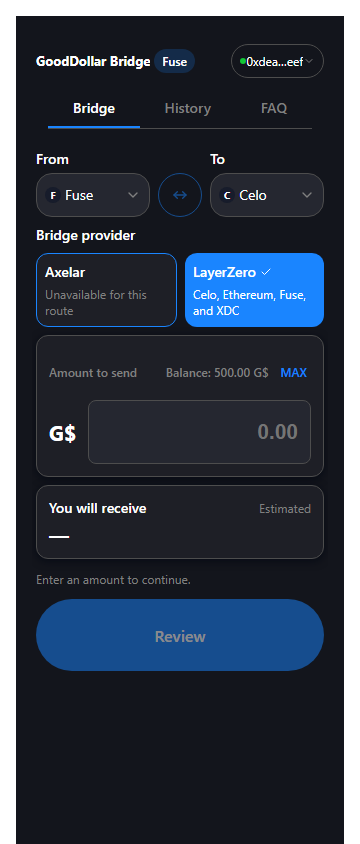 |
| 390 x 844 / light |  | 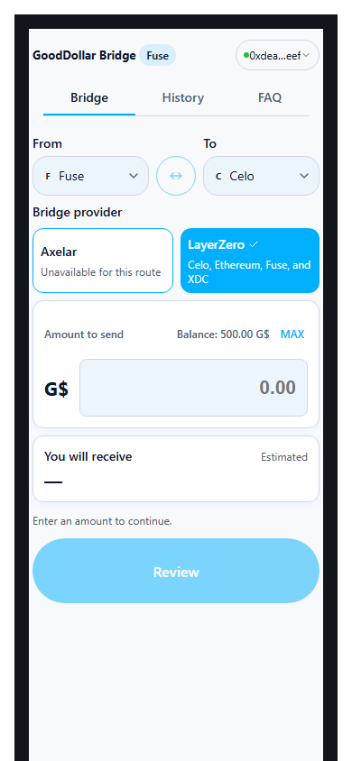 |
| 390 x 844 / dark |  | 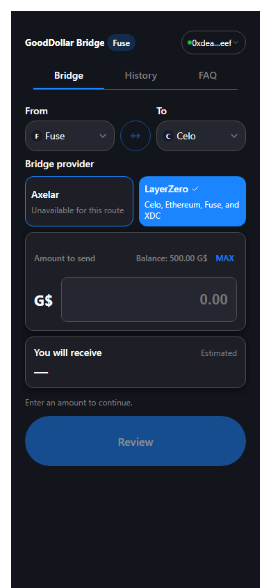 |

Bridge, ready

| Viewport / theme | Reference | Current fixture |
| --- | --- | --- |
| 360 x 844 / light |  | 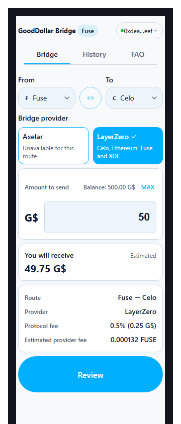 |
| 360 x 844 / dark |  | 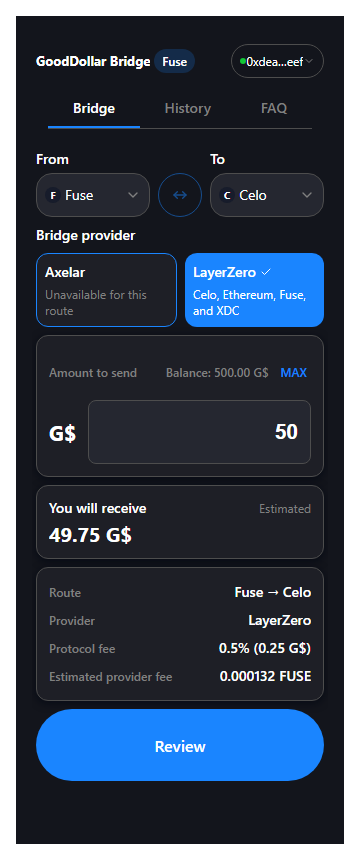 |
| 390 x 844 / light |  |  |
| 390 x 844 / dark |  | 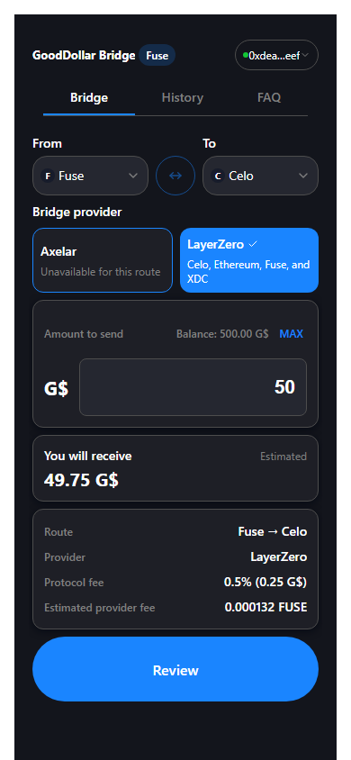 |

Review

| Viewport / theme | Reference | Current fixture |
| --- | --- | --- |
| 360 x 844 / light |  | 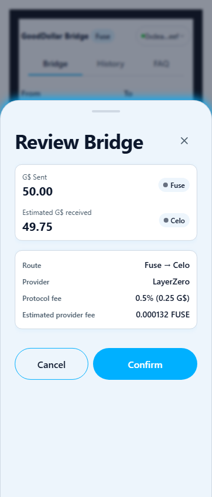 |
| 360 x 844 / dark |  | 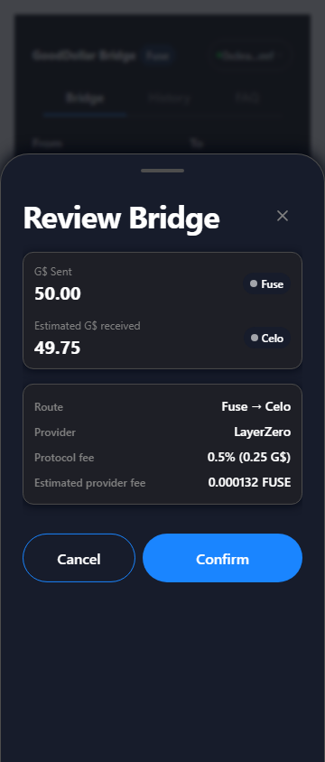 |
| 390 x 844 / light |  | 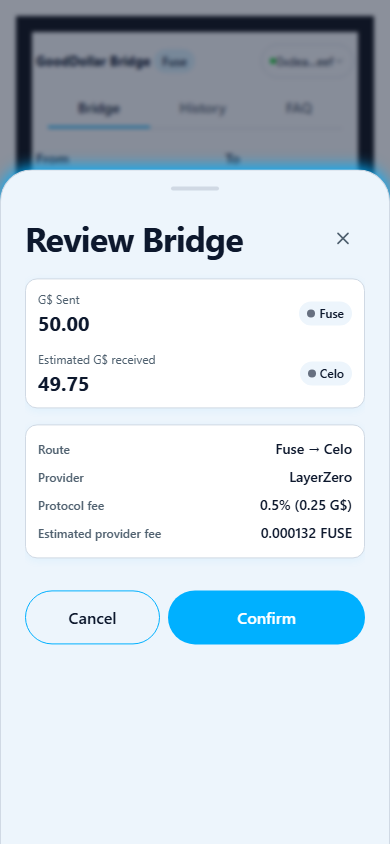 |
| 390 x 844 / dark |  | 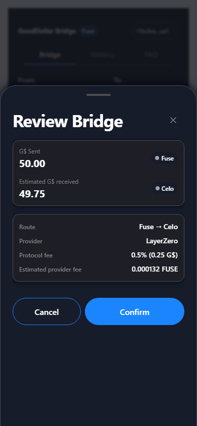 |

In progress

| Viewport / theme | Reference | Current fixture |
| --- | --- | --- |
| 360 x 844 / light |  | 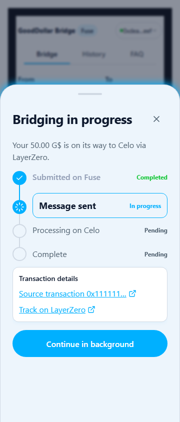 |
| 360 x 844 / dark |  | 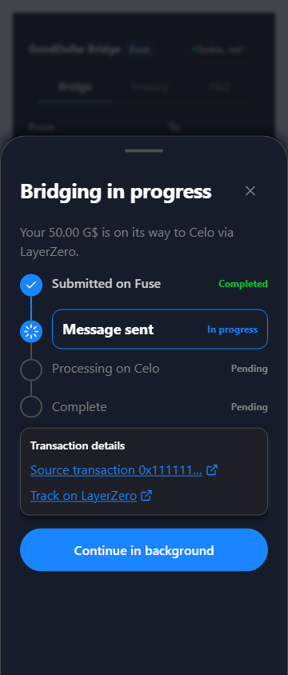 |
| 390 x 844 / light |  | 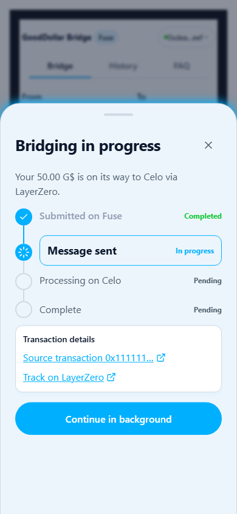 |
| 390 x 844 / dark |  | 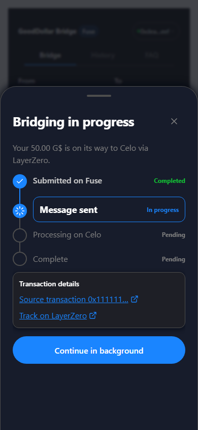 |

Complete

| Viewport / theme | Reference | Current fixture |
| --- | --- | --- |
| 360 x 844 / light |  | 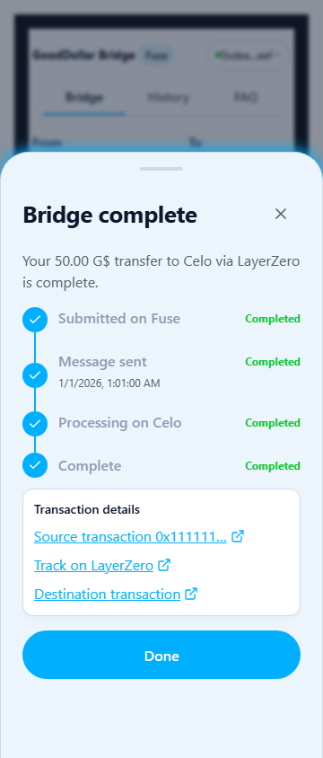 |
| 360 x 844 / dark |  | 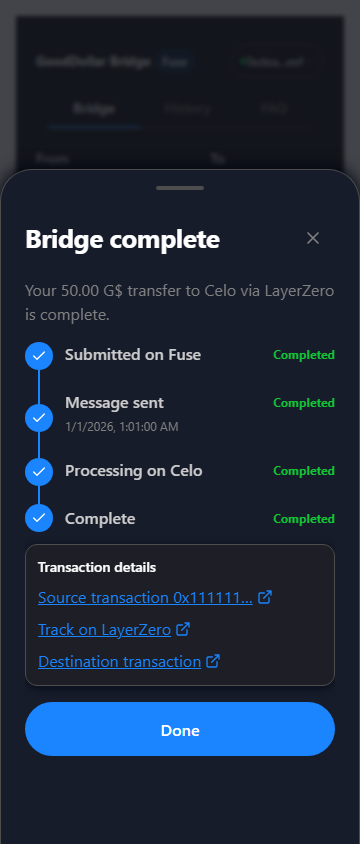 |
| 390 x 844 / light |  | 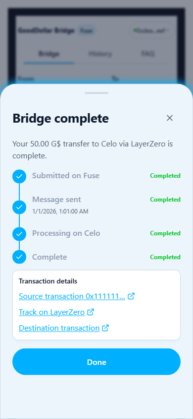 |
| 390 x 844 / dark |  | 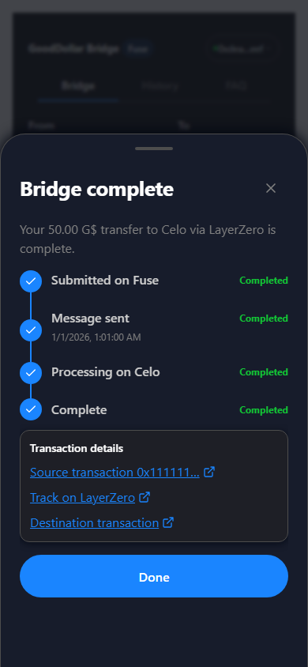 |

History list

| Viewport / theme | Reference | Current fixture |
| --- | --- | --- |
| 360 x 844 / light | No separate reference supplied | 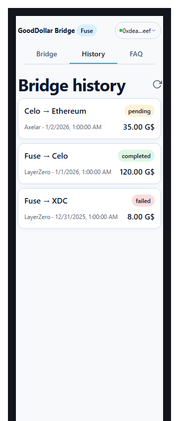 |
| 360 x 844 / dark | No separate reference supplied | 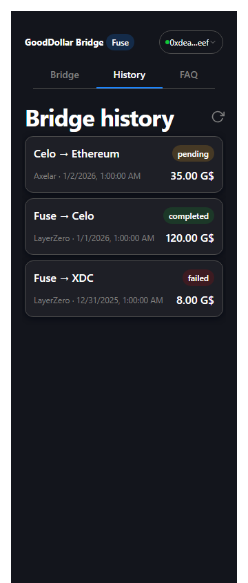 |
| 390 x 844 / light | No separate reference supplied | 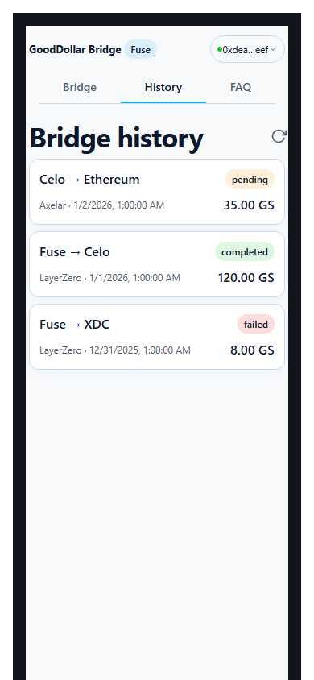 |
| 390 x 844 / dark | No separate reference supplied | 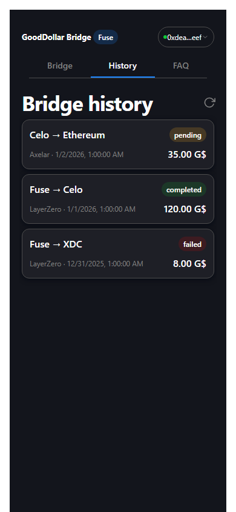 |

History detail

| Viewport / theme | Reference | Current fixture |
| --- | --- | --- |
| 360 x 844 / light |  | 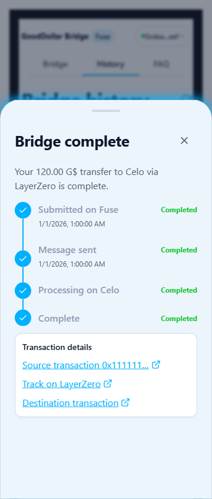 |
| 360 x 844 / dark |  | 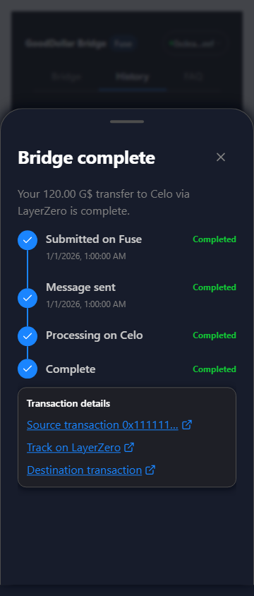 |
| 390 x 844 / light |  | 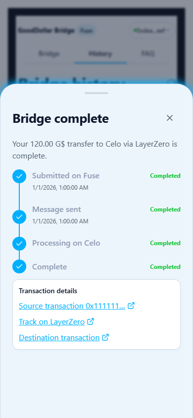 |
| 390 x 844 / dark |  | 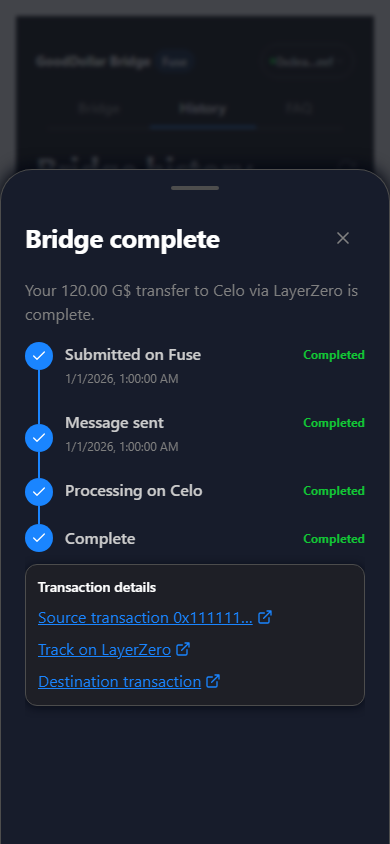 |

Bridge, disconnected (additional coverage)

| Viewport / theme | Reference | Current fixture |
| --- | --- | --- |
| 360 x 844 / light |  | 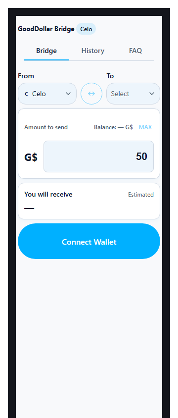 |
| 360 x 844 / dark |  | 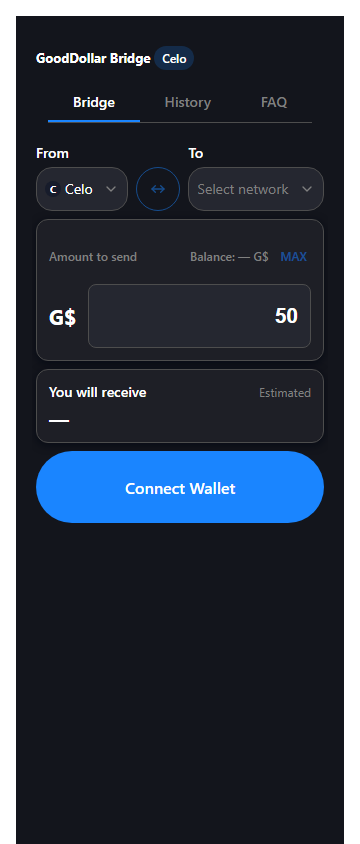 |
| 390 x 844 / light |  | 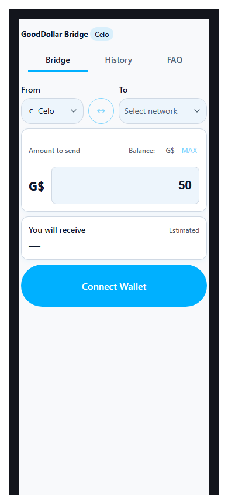 |
| 390 x 844 / dark |  | 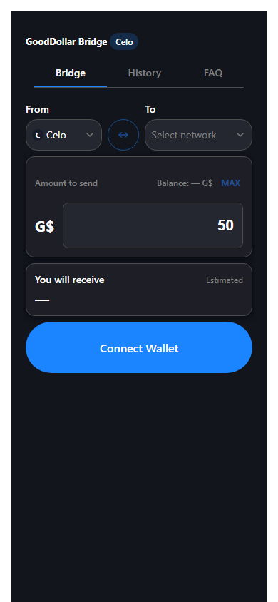 |

## Submission recovery checks

The submission-recovery captures use the mocked wallet/SDK fixture at 390 x 844; the native-funding fixture also covers 360 x 844 and both themes. These are automated adapter/UI checks, not live transaction evidence.

| Case | Expected behavior | Capture |
| --- | --- | --- |
| Fees increase after Review | Request another review; do not automatically submit at the higher fee | [Updated-fee review](test-results/bw-40-fee-change-review.png) |
| Updated quote exceeds native balance | Show the new fee and balance requirement; keep Confirm disabled | [Unaffordable quote](test-results/bw-41-updated-fee-unaffordable.png) |
| Wallet returns a hash, receipt lookup fails | Retain the source explorer link; no one-click Retry; closing clears the amount and refreshes History | [Confirmation unavailable](test-results/bw-42-confirmation-unavailable.png) |
| Transport error contains an insufficient-funds cause | Show the native fee/gas requirement instead of a misleading connection error | [Native funding error](test-results/bw-43-native-funding-error.png) |
| Missing native funds and G$ approval both apply | Show the blocking funding requirement above disabled Review; defer the approval notice until other requirements are met | [360px light](test-results/bw-44-insufficient-native-approval-360-light.png), [360px dark](test-results/bw-44-insufficient-native-approval-360-dark.png), [390px light](test-results/bw-44-insufficient-native-approval-390-light.png), [390px dark](test-results/bw-44-insufficient-native-approval-390-dark.png) |

The Node tests in `packages/bridging-widget/tests/submissionSafety.test.mjs` run the installed SDK's actual approval/bridge sequence against fake clients. They verify the final wallet-write fee ceiling, reuse of an existing approval after re-review, receipt-status checks, preserved transaction hashes, and concurrent-submission rejection. No test signs or broadcasts a real transaction.

## How I tested

- I ran the bridging-widget browser specs with Storybook. The mobile matrix uses Chromium at 360 x 844 and 390 x 844 in both themes. The ready-state check verifies that the entire Review button is visible at scroll position zero.
- Wallet and RPC behavior in automated cases is mocked. I do not present these captures or the automated recording as evidence of live fees, signing, or delivery.
- The SDK reports a provider message creation time, not a timestamp for every milestone. I display source time when known in History and message time when supplied by the provider; I do not invent destination or completion times.
- I have not yet completed the requested live Fuse-to-Celo recording in a phone or GoodWallet development build. The planned manual check is to use a funded test wallet, choose Fuse to Celo via LayerZero, enter an amount above the quoted minimum, and review both fees before confirming. I will record the wallet confirmation and progress and note the device, browser/build, wallet, amount, and source/destination hashes. If destination delivery finishes after the recording, I will add its explorer link separately.
- I will not bypass wallet recording restrictions. If I cannot capture the signing screen, I will record the widget before and after signing, include the actual explorer links, and disclose the missing wallet segment. An approval hash alone is not proof of a bridge transfer or destination delivery.

## Manual verification and remaining evidence

- Earlier evidence remains separate: I previously supplied the October Celo-to-Ethereum/Axelar recording and source/destination transaction links in the PR description. That historical test is separate from my November approval-only attempt and is not the newly requested Fuse-source phone recording.
- Device: I used a Samsung Galaxy S9 (`SM-G960U`) with the MetaMask Mobile browser, connected to local Storybook through USB port forwarding. I did not record browser/wallet version numbers.
- Celo attempt: I rechecked [transaction `0x38abcf...d3f538`](https://celoscan.io/tx/0x38abcf725a53a7888b515f95c6cce344226f073bd40b6cf5220c6924b0d3f538) through Celo Blockscout on 2026-11-23. It succeeded on 2026-11-19 and calls `approve` for 10 G$ from my wallet `0x18883C2FF5a84b7F686FF0cfd400c6F3D6068b07` to the source bridge spender `0xa3247276DbCC76Dd7705273f766eB3E8a5ecF4a5`. The widget subsequently reported a bridge-step network error. This is evidence of the approval only, not a bridge transfer or destination delivery. I have not established the original failure's precise cause.
- Fuse to Celo via LayerZero: I entered 5 G$, saw a 0.005 G$ protocol fee and an estimated provider fee of approximately 230.45 FUSE, and confirmed that Review was disabled. After the warning fix, I confirmed that the insufficient-native-balance explanation appeared. I did not sign a transfer for this check.
- Fee investigation: the public [GoodDollar fee endpoint](https://goodserver.gooddollar.org/bridge/estimatefees) returned `LZ_FUSE_TO_CELO = 209.32982723773736 Fuse` on 2026-11-23. SDK 1.0.6 adds a 10% buffer, consistent with a roughly 230 FUSE display. This verifies the display path, not the economic reasonableness or eventual acceptance of that provider estimate. Quotes fluctuate; this is not a current funding instruction.
- Capture limitation: MetaMask's recording restriction prevented me from capturing the wallet confirmation. A later Android screenshot attempt also failed; I have no usable phone screenshot from that attempt. I do not present the automated video or screenshots as the missing live recording.
- Still outstanding: I have not completed the requested successful phone/development-build transfer recording, preferably Fuse to Celo to exercise Fuse as the source. I disclose this limitation for review; I do not claim that this live-evidence checklist item is complete or that the widget is production-ready.

## Verification on 2026-11-23

- Bridge Node tests: `node --experimental-strip-types --test packages/bridging-widget/tests/*.test.mjs`, 25/25 passed.
- Chromium: all bridging-widget specs plus `tests/widgets/streaming-widget/states.spec.ts`, 74/74 passed, one worker, retries disabled. The run used the existing local Storybook server and a temporary configuration changing only the base URL, output location, reporter, and automatic-server startup. Earlier environment/setup failures were corrected before this clean run.
- The installed `tsup` package build commands passed for `@goodwidget/ui` and `@goodwidget/bridging-widget`, including declarations. Targeted ESLint passed for all changed source, stories, and test files.
- Full-workspace install/build/lint are not certified by this pass. The available pnpm entrypoint attempted package linking before the selected build and failed with `EPERM`; direct installed tools were used instead. No dependency or lockfile changes were made.
- All 40 distinct local image links in this document resolve to saved captures. Wallet responses, fees, and delivery in automated captures are mocked; the manual evidence above is documented separately.
